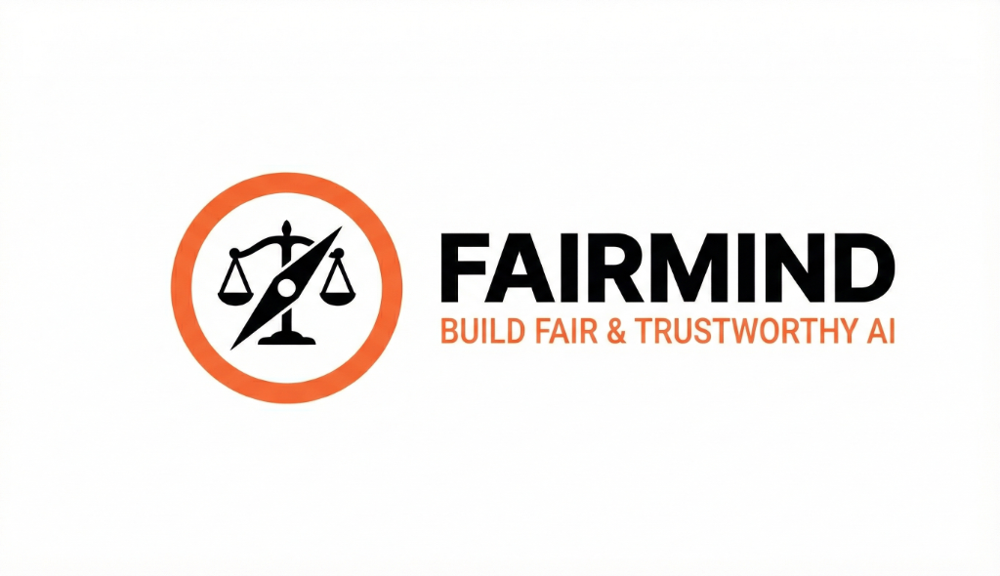

<div align="center">
  
</div>

<br>

<div align="center">

**Banco de trabajo de código abierto para el aseguramiento de modelos y agentes de IA**

*Trae tus pruebas. Produce evidencia que puedas defender.*

[](LICENSE)
[](https://github.com/adhit-r/fairmind/issues?q=is%3Aissue+is%3Aopen+label%3A%22good+first+issue%22)
[](https://github.com/adhit-r/fairmind/graphs/contributors)
[](CONTRIBUTING.md)

[Sitio web](https://fairmind.xyz) | [Documentación](https://docs.fairmind.xyz) | [Cómo contribuir](CONTRIBUTING.md) | [Discusiones](https://github.com/adhit-r/fairmind/discussions) | [Read in English](README.md)

</div>

---

## Qué es FairMind

FairMind es una plataforma de gobernanza y aseguramiento para sistemas de IA, incluidos los agentes basados en LLM. Un equipo registra un sistema de IA, activa un marco de gobernanza como AIUC-1, NIST AI RMF, la Ley de IA de la UE o la Ley DPDP de India, y trabaja los controles que aplican: ejecuta evaluaciones, adjunta evidencia de sus propias herramientas, revisa hallazgos, corrige fallos y vuelve a probar. El resultado es un rastro de evidencia con versiones fijadas que un revisor interno o un auditor externo puede seguir desde un requisito hasta la evidencia que lo respalda.

FairMind apoya la preparación y la revisión. No certifica el cumplimiento, no aprueba sistemas automáticamente y no aplica políticas por sí solo.

**Estado: alfa interna.** El contrato de evidencia y las bases de confianza y revisión están construidos y probados; los workers de evaluación aislados y los paquetes de evaluación validados para LLM, agentes y multimodales aún no están disponibles. Consulta [docs/STATUS.md](docs/STATUS.md) (en inglés) para ver exactamente qué se puede afirmar hoy y qué no.

## Inicio rápido

Necesitas Python 3.11+, [uv](https://docs.astral.sh/uv/getting-started/installation/), Node.js 20+ y npm. También necesitas PostgreSQL 14+ (local, Docker o una rama de Neon) con una base de datos vacía.

```bash
git clone https://github.com/adhit-r/fairmind.git
cd fairmind
```

**Backend** (primera terminal):

```bash
cd apps/backend
cp config/env.example .env        # pon en DATABASE_URL tu base de datos PostgreSQL vacía
uv sync
uv run python scripts/setup_db.py # esquema + datos de referencia AIUC-1; se puede repetir
uv run uvicorn api.main:app --reload --port 8000
```

Cuando esté listo, la documentación de la API está en http://localhost:8000/docs.

**Frontend** (segunda terminal):

```bash
cd apps/frontend
echo "BACKEND_INTERNAL_URL=http://localhost:8000" > .env.local
npm install
npm run dev
```

Abre http://localhost:1111, crea una cuenta en la página de registro e inicia sesión.

Si algo falla durante la instalación, abre un issue con el comando que ejecutaste y el error que obtuviste.

## Estructura del repositorio

| Ruta | Qué contiene |
|---|---|
| `apps/backend/` | Backend FastAPI (Python, uv): APIs de gobernanza, evaluación, evidencia y cumplimiento |
| `apps/frontend/` | Panel Next.js (TypeScript, Tailwind, pruebas con Playwright) |
| `apps/docs/` | Sitio de documentación publicado en docs.fairmind.xyz |
| `apps/website/` | Sitio de marketing (Astro) |
| `apps/ml/` | Modelos de ML y utilidades de visualización |
| `docs/` | Notas de arquitectura, ADR, auditorías y planes |

## Ejecutar las pruebas

```bash
cd apps/backend && uv run pytest
cd apps/frontend && npm run test
```

Las pruebas del frontend usan Playwright; ejecuta `npx playwright install` una vez antes de la primera ejecución. Consulta [CONTRIBUTING.md](CONTRIBUTING.md) para el flujo completo.

## Cómo contribuir

Las contribuciones son bienvenidas, desde corregir erratas hasta paquetes de evaluación. Empieza por [CONTRIBUTING.md](CONTRIBUTING.md) (en inglés) y elige un issue con la etiqueta [good first issue](https://github.com/adhit-r/fairmind/issues?q=is%3Aissue+is%3Aopen+label%3A%22good+first+issue%22) o [help wanted](https://github.com/adhit-r/fairmind/issues?q=is%3Aissue+is%3Aopen+label%3A%22help+wanted%22). Las preguntas e ideas van a [GitHub Discussions](https://github.com/adhit-r/fairmind/discussions).

Se espera que todas las personas que participan sigan el [Código de Conducta](CODE_OF_CONDUCT.md).

## Seguridad

No reportes vulnerabilidades en issues públicos. Consulta [SECURITY.md](SECURITY.md) para reportarlas de forma privada.

## Licencia

MIT. Consulta [LICENSE](LICENSE).
