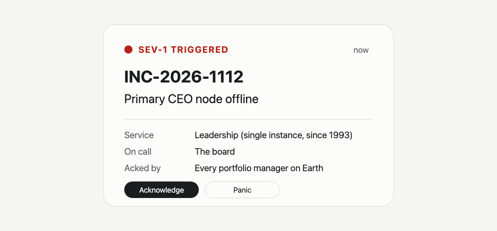

Every on-call engineer knows the feeling. The pager goes off, the dashboard turns red, and somewhere a manager types "any update?" into a channel that is already on fire.

On 12 November 2026 the AI industry got that page. Nvidia announced that its chief executive had resigned, effective immediately. Half the internet started speculating about why. We did what security people do instead: we opened an incident ticket.

Ground rules first. This is a blameless post-mortem. Nvidia has not said why its chief executive left, the press reports about reasons are unconfirmed, and a good post-mortem never puts a human being in the root cause box anyway. We are reviewing the system, not the person. The system, in this case, is "what happens when the one person everybody depends on is suddenly not there", which is the most under-rehearsed failure mode in AI governance.

## Incident summary

| Field | Entry |
|---|---|
| Ticket | INC-2026-1112 |
| Title | Primary CEO node offline |
| Declared by | Press release, which is not where most incidents are declared |
| Severity | SEV-1. SEV-0 if you hold the stock. |
| Component | Leadership, single instance, in service since 1993 |
| Uptime before incident | Roughly 33 years, which would embarrass most cloud providers |
| Status | Mitigated. Interim instance serving traffic. |
| Root cause | Not disclosed. We checked. Please stop asking. |

## Timeline

| When | Event |
|---|---|
| 12 Nov 2026 | Nvidia announces that Jensen Huang has resigned as president, chief executive and board member, effective immediately. The pager goes off for roughly every portfolio manager on Earth. |
| Same press release | Failover. Colette Kress, the chief financial officer, becomes interim chief executive and keeps the CFO job too, which makes her incident commander, finance team and on-call rotation at once. |
| Same press release | The release describes Harvey C. Jones as the board's first-ever chair. A second node appears in the cluster. |
| Same press release | Status page update: the board expects operations, customer commitments and the product roadmap to continue without interruption. The search for a permanent replacement will consider internal and external candidates. |
| Market close | Shares close down 4.3% on the day, according to CNBC. |
| 17 Nov 2026 | Quarterly results, as previously scheduled. The change freeze holds. |

## Impact

External impact: one bad day on the stock chart, an unknown number of hot takes, and at least one blog that turned it into an incident ticket.

Internal impact, which is the part a post-mortem actually cares about: did anything stall because the person who usually decides was gone? From the public record, no. The results date held and the release said who was in charge. Mean time to recovery was about one paragraph.

## Detection

None. There was no alert, no slow-burning dashboard, no Grafana panel creeping toward the red line. The incident arrived fully formed, already declared, effective the same day.

This is the worst kind of incident to plan for and therefore the one you most need to rehearse. Your monitoring will not page you when your approver hands in their badge. You find out when the release is waiting and the approve button belongs to someone who no longer works there.

<!-- GIF CARD: Marvel, Endgame "I don't feel so good" snap fade. In Ghost: + > GIF > search "i dont feel so good".
Caption: Your only AI release approver, ten minutes after accepting an offer somewhere with better snacks. -->

## What went well

<!-- GIF CARD: Marvel, Endgame "Avengers assemble". In Ghost: + > GIF > search "avengers assemble".
Caption: The interim CEO, the new chair and the unchanged results date, all arriving in the same press release. -->

- **Failover in the same message.** The departure and the replacement arrived together. At no point was the public status "CEO: 404 Not Found".
- **The standby already had production access.** The interim chief executive was the sitting CFO, someone the board and investors already trusted and who knew the numbers going into results week. Nobody had to onboard her or reset her password.
- **The change freeze held.** Keeping the results date as previously scheduled told everyone that quarterly reporting does not depend on one person. That is the corporate version of "the deploy pipeline still works".
- **A real status page.** The board said what it expected to continue and what happens next. Plenty of companies can't manage that for a login outage.

## Root cause

Not disclosed. Nvidia's release gave no reason. Press reports about reasons are unconfirmed, and we do not repeat them here.

A blameless post-mortem would not have put a person in this box anyway. "Root cause: Dave" is how you get a culture where nobody files incidents. The useful question is which conditions turned the loss of one person into a SEV-1, which brings us to contributing factors.

## Contributing factors

These are the standard questions any incident review asks. They are not findings against Nvidia, which has not published its own review and does not need ours.

1. **Single point of failure.** When one person has run a company for 33 years, a great deal of decision-making and credibility runs through one node. In normal operation that is called vision. In an outage it is called a single point of failure.
2. **High availability arrived during the incident.** The release describes the new chair as the board's first. Separating the chair and chief executive roles is the classic control for exactly this event, because one seat stays filled when the other empties.
3. **Succession readiness.** Naming an interim leader the same day suggests a runbook existed. Whether the permanent replacement was ready is a separate ticket the board is still working.

## Now run the same review on yourself

Here is where the joke turns on the reader. Nvidia had a standby ready in the same press release. Now picture your AI release process.

Your high-risk model update is ready to ship. The person who signs it off is Priya, because Priya has always signed it off. Priya has just accepted an offer somewhere with better snacks. Who approves the release on Monday?

<!-- GIF CARD: The Office, Pam "they're the same picture". In Ghost: + > GIF > search "same picture office".
Caption: Corporate needs you to find the differences between "Priya approves it" and "the release approver role, which only Priya holds". -->

If the answer is "we would figure it out", that is not a failover plan, it is a hope. And regulators do not accept hopes. The [EU AI Act](https://eur-lex.europa.eu/eli/reg/2024/1689/oj) expects deployers of high-risk systems to assign human oversight to people with the competence, training and authority to do it (Article 26). [ISO/IEC 42001](https://www.iso.org/standard/42001) asks top management to assign responsibilities and authorities for the AI management system (clause 5.3). "Priya, because she always does it" meets neither.

<!-- GIF CARD: The Office, Dwight "assistant to the regional manager". In Ghost: + > GIF > search "assistant to the regional manager".
Caption: Every AI team, asked to name the deputy approver: "We have an assistant to the regional approver. Kind of." -->

<!-- GIF CARD: The Office, Michael Scott "I declare bankruptcy". In Ghost: + > GIF > search "i declare bankruptcy".
Caption: Declaring your AI governance programme audit-ready without checking who can approve a release. -->

## Action items

| Action | Owner | Why |
|---|---|---|
| Tie each release approval to a role, not a person | AI governance lead | Roles can be handed over. Habits leave with Priya. |
| Name a deputy for every role that can approve a release | Head of the function | This is your failover node. Nvidia had one. Your AI release process probably does not. |
| Record every approval as a decision with a name, a date and a reason | Every approver | Old approvals stay valid as evidence after the approver leaves, but only if they were written down somewhere other than Slack. |
| End access when someone leaves, not when their session expires | Platform owner | "Effective immediately" should mean the same thing in your governance tool as it does in a press release. |
| Run a game day once a quarter: assume your approver resigned at lunch | AI governance lead | Chaos engineering, but for org charts. You only learn whether failover works by trying it. |

## Lessons learned

Most AI governance programmes have a plan for when a model fails. Very few have one for when the approver goes away. But the person who signs the release is part of the system just as much as the model is, and losing them should trigger a runbook, not a group chat called "what do we do now".

The best thing in Nvidia's announcement was not about the person who left. It was that the name of the person now in charge appeared in the same message. Your AI release process should be able to do the same.

## Where FairMind fits

In FairMind every release decision records who made it, when and with what notes, and stays in the system's file as evidence after that person has gone. The governance plan asks who holds each role when you set it up, and access ends on the next request when someone is removed from the organisation. Naming the deputy is still up to you. We cannot hire Priya's replacement for you.

## Sources
- [NVIDIA Announces CEO Transition](https://nvidianews.nvidia.com/news/nvidia-announces-ceo-transition), NVIDIA press release, 12 November 2026.
- [Nvidia CEO Jensen Huang resigns: live updates](https://www.cnbc.com/2026/11/12/nvidia-jensen-huang-ceo-live-updates.html), CNBC, 12 November 2026, for the share price move.
- [Regulation (EU) 2024/1689, the AI Act](https://eur-lex.europa.eu/eli/reg/2024/1689/oj), Article 26 on obligations of deployers of high-risk AI systems.
- [ISO/IEC 42001:2023](https://www.iso.org/standard/42001), clause 5.3 on roles, responsibilities and authorities, as described in public summaries.

<!-- REVIEWER NOTES (not for publication)
- Humour targets the incident-report format, markets and generic org habits only. No jokes about Huang personally, his conduct or the reasons for leaving; keep it that way in edits.
- Facts come from the NVIDIA press release (read in full 13 Nov 2026) and CNBC's verbatim text for the 4.3% close. Re-read both on publish day.
- Deliberately excluded: reported reasons for the departure, any investigation, the class action, congressional testimony reports, successor speculation and intraday stock figures. They are allegations or unconfirmed.
- "In service since 1993" / "33 years": Huang has been CEO since co-founding Nvidia in 1993. Confirm.
- "Mean time to recovery was about one paragraph" is a joke about the format, not a claim about Nvidia's recovery.
- "First-ever chair" is the release's wording. Contributing factors are framed as standard review questions, not findings.
- Time-sensitive: publish before or around 17 Nov results; afterwards update the timeline.
- Article 26(2) wording: confirm "competence, training and authority" against the OJ text.
- FairMind claims checked in code: approvals store decided_by, decided_at and notes (apps/backend/src/api/routers/approvals.py); role holders in plan discovery (4a933197); access ends on next request after removal (1b895870, cd1aee23). No deputy or delegation feature exists.
- "Priya" and "Dave" are illustrative names, not real people.
- Memes: 01-pager.png is our own image (upload it to Ghost and replace the relative path). The five GIF CARD comments are The Office and Marvel templates: add each with the Ghost editor GIF card (Tenor search, embedded under Tenor terms), paste the caption as the card caption, then delete the comment. Do not download and re-upload studio stills. Pick GIFs without on-screen text that changes the joke. None should show Huang or anyone from Nvidia.
-->
